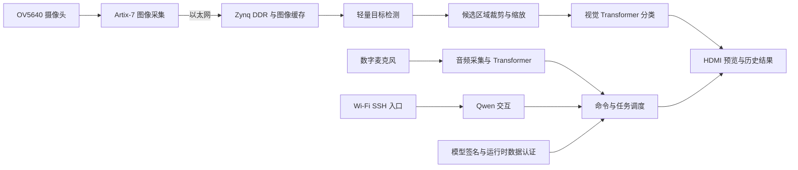

# 面向安全认证的视觉 NPU 与 Qwen 交互系统

[English](README.en.md)

本项目实现了一套基于双 FPGA 的视觉感知与交互原型：使用摄像头采集图像，由轻量目标检测网络定位候选区域，再通过视觉 Transformer 对目标进行细粒度分类；系统结合模型与数据认证、音频命令入口、无线交互和多画面显示，探索端侧智能推理与可信执行的协同设计。

演示采用猫咪图像作为细粒度分类对象：检测网络定位猫的位置，视觉 Transformer 对候选区域进行品种分类。猫咪照片易于准备和更换，适合展示目标检测、图像裁剪、细粒度识别及结果追溯的完整链路。

## 系统架构

图中表示主要功能和数据关系；不同版本的实际连线、任务调度和已验证范围应以对应工程与测试记录为准。

## 功能与设计

### 视觉检测与识别

- **图像采集与预览：** OV5640 采集的图像经板间以太网传输、DDR 缓存后，在 HDMI 上显示实时预览和历史识别结果。
- **候选区域检测：** 基于轻量目标检测网络定位目标，并将检测框映射到显示画面和候选区域。
- **细粒度分类：** 对候选区域进行裁剪、缩放及输入编码，再由 12 个 Transformer Block 完成视觉特征提取和分类。
- **结果管理：** 保存图像、检测框和识别信息，支持从历史图片中选择画面展示。实际可用记录以运行时已保存的数据为准。

### 音频与远程交互

数字麦克风经 I2S 输入音频，音频路径包含采样、特征提取、Transformer 编码和命令映射，供受控操作使用。离线音频样本的结果与真实麦克风环境下的识别效果需要分别评估。

ESP32-C3 提供无线连接入口，通过串口与交互侧配合，支持通过 SSH 发送请求；Qwen 可用于自然语言交互，并与系统状态和历史图片查询结合。实际命令格式、连接地址和当前设备状态以交付说明及运行配置为准。

### 安全执行

系统设计包含模型清单签名验证与运行时数据认证：初始化或模型切换时检查模型授权，运行期间对模型数据及执行相关信息进行认证。安全控制逻辑与任务调度协同，认证失败或状态无效时不应将对应结果视为有效识别结果。具体保护范围和实际运行状态以工程版本及测试记录为准。

## 硬件组成

| 组成 | 主要职责 |
| --- | --- |
| Zynq-7000 开发板（XC7Z035） | PS 控制、DDR 数据管理、视觉与音频任务、认证逻辑及 HDMI 输出 |
| Artix-7 开发板（XC7A100T） | 摄像头采集、图像传输与 Qwen 交互相关逻辑 |
| ESP32-C3 | Wi-Fi 连接与串口交互入口 |
| OV5640 与数字麦克风 | 图像与音频输入 |

## 资料下载

本仓库默认分支提供双板工程源码资料及目录说明。以下完整交付资料位于 **[weight_parts 分支](https://github.com/1incherry/48567/tree/weight_parts)**：

- [完整源码与 IP 交付 RAR](https://github.com/1incherry/48567/blob/weight_parts/fpgachina2026-48657.rar)：包含工程资料、IP 文件、约束与脚本、PS 相关代码、迁移指南、文件层次和协作记录。
- [模型权重及重组说明](https://github.com/1incherry/48567/tree/weight_parts/weights)：Qwen 与 NPU 模型以分卷存放，下载后按说明合并，并使用 SHA-256 清单核对。
- 默认分支根目录还提供分别整理的双板源码包和文件层次说明。

Qwen 文件为硬件权重参考数据，与特定板上加载版本的匹配关系需要结合对应工程核对。权重、公开认证材料和密钥是不同的对象；仓库不提供私有签名密钥。

## 复现与使用

1. 下载交付 RAR 并解压，阅读其中的文件层次说明和 **Vivado / Vitis 2026.1 分步复现指南**。
2. 在工程副本中检查 FPGA 器件、源文件、Block Design、约束及 IP 状态；必要时升级 IP 并生成输出文件。
3. 对照原工程核查 DDR、时钟、复位、地址映射和接口；重新综合、实现及导出硬件平台后，再按匹配的平台构建 PS 程序和启动文件。
4. 根据模型分卷说明准备权重与认证资料，检查 JTAG 脚本所绑定的器件和路径，再进行板级部署与调试。

100T 迁移副本的逐项 IP 升级与 Block Design 校验已有记录；相关接口变化仍须结合综合检查。不同工具版本生成文件、已有网表与实际板级结果不可互相替代，具体进度和限制见交付包说明。

## 材料与许可

仓库包含项目源代码、工程描述、约束、脚本和模型资料索引。第三方 IP、模型和工具受各自许可证约束；使用和分发前请核对对应许可。
